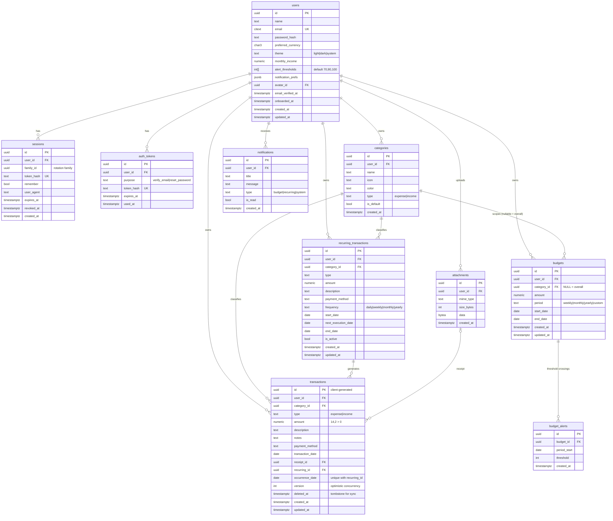

# ExpenseFlow — Architecture

> Premium, offline-first personal finance PWA.
> This document is the source of truth for design decisions. Update it when they change.

---

## 1. System overview

```
┌──────────────────────────── Browser / Installed PWA ────────────────────────────┐
│                                                                                 │
│  React 18 + TS (Vite)                                                            │
│  ├─ UI: Tailwind + shadcn/ui (Radix) + Lucide + Framer Motion + Recharts         │
│  ├─ Server state: TanStack Query  ──persisted──►  IndexedDB (Dexie: kv)          │
│  ├─ Client state: Zustand (auth, prefs, sync status)                             │
│  ├─ Local-first data: Dexie  { transactions mirror, outbox, categories, kv }     │
│  └─ Sync engine: outbox flush + delta pull (online / focus / interval / BG sync) │
│                                                                                 │
│  Service Worker (Workbox, injectManifest)                                        │
│  ├─ precache app shell  ├─ SPA navigation fallback  ├─ offline.html              │
│  └─ Background Sync tag → asks open clients to flush the outbox                  │
└───────────────────────────────┬─────────────────────────────────────────────────┘
                                │ HTTPS, JSON, httpOnly cookies + CSRF header
┌───────────────────────────────▼─────────────────────────────────────────────────┐
│  Node 22 + Express (TypeScript)                                                  │
│  helmet → cors → pino-http → cookie-parser → rate-limit → csrf → auth → routes   │
│  routes → controllers → services (business rules, Decimal math) → repositories   │
│  jobs/  node-cron: recurring transactions (idempotent), session cleanup          │
└───────────────────────────────┬─────────────────────────────────────────────────┘
                                │ Drizzle ORM (parameterised), pooled TLS
                       ┌────────▼────────┐
                       │ Neon PostgreSQL │   (PGlite in-process for local dev/tests)
                       └─────────────────┘
```

### Repository layout (npm workspaces)

```
/
├─ shared/     @expenseflow/shared – Zod schemas, DTO types, constants, money helpers
├─ backend/    Express API, Drizzle schema + migrations, jobs, tests
├─ frontend/   React PWA
└─ docs/       architecture, deployment
```

`shared` is consumed as TypeScript source: Vite compiles it for the frontend, `tsx` runs it in dev,
and `tsup` bundles it into the backend build. One schema validates on both sides.

---

## 2. Database ERD



### Constraints and indexes (summary)

| Table | Constraint / index |
|---|---|
| users | `UNIQUE(lower(email))`, `CHECK theme IN (...)`, `CHECK monthly_income >= 0` |
| categories | `UNIQUE(user_id, type, lower(name))`, `CHECK type`, idx `(user_id)` |
| transactions | `CHECK amount > 0`, `CHECK type`, `CHECK payment_method`, `UNIQUE(recurring_id, occurrence_date)`, idx `(user_id, transaction_date DESC) WHERE deleted_at IS NULL`, idx `(user_id, updated_at)` for delta sync, idx `(user_id, category_id)` |
| budgets | `CHECK amount > 0`, `CHECK end_date >= start_date`, `CHECK period='custom' ⇒ end_date NOT NULL`, `UNIQUE NULLS NOT DISTINCT (user_id, category_id, period, start_date)` |
| budget_alerts | `UNIQUE(budget_id, period_start, threshold)` ← the duplicate-alert guard |
| recurring | `CHECK amount > 0`, `CHECK frequency`, partial idx `(next_execution_date) WHERE is_active` |
| sessions | `UNIQUE(token_hash)`, idx `(user_id)`, idx `(expires_at)` |
| FK rules | everything user-owned `ON DELETE CASCADE` from users; `transactions.category_id ON DELETE RESTRICT` (the API moves rows to *Others* first); `transactions.recurring_id ON DELETE SET NULL`; `receipt_id ON DELETE SET NULL` |

**Money** is `NUMERIC(14,2)` in Postgres and always travels as a **string** (`"1234.50"`) over the wire.
Arithmetic uses `decimal.js` on the server and client. Aggregates (`SUM`) run in SQL. JS `number` is never used for money.

**Attachments** (receipts, avatars) live in Postgres `bytea` (≤ 5 MB, magic-byte validated). That keeps the
backend stateless and works on ephemeral hosts. Object storage is a drop-in swap behind `attachments.service`.

---

## 3. Frontend component hierarchy

```
<App>
 ├─ <QueryProvider persistent=IndexedDB>  <ThemeProvider>  <Toaster/>  <SyncProvider/>
 └─ <Router>
     ├─ <AuthLayout>                      (split hero on desktop, single column on mobile)
     │   ├─ LoginPage · RegisterPage · ForgotPasswordPage · ResetPasswordPage · VerifyEmailPage
     ├─ <RequireAuth> → <OnboardingPage>  (5 animated steps, stepper, skip)
     └─ <RequireAuth> → <AppLayout>
         ├─ <Sidebar collapsible/>        (≥ lg)
         ├─ <BottomNav/> + <FabAdd/>      (< lg)
         ├─ <TopBar> greeting · MonthSwitcher · SyncBadge · NotificationBell · Avatar
         ├─ <OfflineBanner/> <InstallPrompt/> <VerifyEmailBanner/>
         └─ <Outlet/> (lazy routes)
             ├─ DashboardPage
             │   ├─ BalanceHero (balance + income/expense/savings tiles)
             │   ├─ QuickActions
             │   ├─ SpendingOverviewCard (area chart, vs previous month, % change)
             │   ├─ CategoryDonutCard
             │   ├─ BudgetProgressCard
             │   └─ RecentTransactionsCard → TransactionRow
             ├─ TransactionsPage
             │   ├─ SearchBar(debounced) · FilterSheet(type, category, dates) · SortMenu
             │   └─ TransactionGroupList → DayGroupHeader(total) → TransactionRow (swipe-free actions menu)
             ├─ TransactionFormPage (new / edit / duplicate)
             │   ├─ TypeToggle · AmountInput(large tabular) · CategoryGrid · PaymentMethodChips
             │   └─ DateField · Description · Notes · ReceiptPicker
             ├─ AnalyticsPage → RangePicker · InsightsCarousel · 6 chart cards
             ├─ BudgetsPage → BudgetSummary · BudgetCard[] · BudgetFormDialog
             ├─ CategoriesPage → CategoryList · CategoryFormDialog (icon + colour picker)
             ├─ RecurringPage → RecurringCard[] · RecurringFormDialog
             ├─ NotificationsPage
             ├─ ProfilePage (mobile hub) → links + quick settings
             └─ SettingsPage → Account · Security · Preferences · Notifications · Data export · Danger zone
```

State boundaries:

| Kind | Where |
|---|---|
| Server aggregates (analytics, budgets, categories, recurring, me) | TanStack Query, persisted to IndexedDB for offline viewing |
| Transactions | Dexie mirror (`liveQuery`), kept fresh by the sync engine. Filter, search, sort and grouping run locally, so the list works offline and responds immediately |
| Pending writes | Dexie `outbox` |
| UI / session | Zustand (`auth`, `ui`, `sync`) |

Feature folders (`features/<name>/{api,components,hooks}`) hold domain code. `components/ui` holds shadcn primitives,
`components/` holds app-wide composites.

---

## 4. Backend API design

Conventions: JSON, `camelCase`, money as strings, dates `YYYY-MM-DD`, errors
`{ error: { code, message, details? } }`, list responses `{ data, nextCursor? }`.
Every query is scoped by `req.user.id` from the verified access token. Body or query `userId` is never read.

| Method | Path | Notes |
|---|---|---|
| GET | /api/auth/csrf | issues CSRF token (cookie + body) |
| POST | /api/auth/register | creates user + default categories, sends verification |
| POST | /api/auth/login | `{email,password,remember}` → sets cookies |
| POST | /api/auth/logout | revokes session |
| POST | /api/auth/logout-all | revokes every session |
| POST | /api/auth/refresh | rotates refresh token (reuse ⇒ family revoked) |
| POST | /api/auth/forgot-password | always 202 (no user enumeration) |
| POST | /api/auth/reset-password | `{token,password}` revokes all sessions |
| POST | /api/auth/verify-email · /resend-verification | |
| GET/PATCH | /api/users/me | profile + preferences + onboarding |
| POST | /api/users/me/password · /email · /avatar | password confirmation required |
| DELETE | /api/users/me | `{password}` → cascade delete |
| GET | /api/transactions | `?cursor&limit&type&categoryId&from&to&q&sort` keyset pagination |
| POST | /api/transactions | client UUID `id` = idempotency key |
| GET/PUT/DELETE | /api/transactions/:id | PUT takes `version`; mismatch → 409 + current row |
| POST | /api/transactions/:id/receipt · GET receipt | multipart, 5 MB, jpeg/png/webp/pdf |
| GET | /api/sync/pull?since= | delta incl. tombstones + server cursor |
| GET/POST/PUT/DELETE | /api/categories[/:id] | delete reassigns to *Others* |
| GET/POST/PUT/DELETE | /api/budgets[/:id] | GET returns spend/progress for current period |
| GET | /api/analytics/overview?from&to | totals, balance, savings, previous-period deltas |
| GET | /api/analytics/monthly?months= | income/expense/savings per month |
| GET | /api/analytics/categories?from&to&type | breakdown + previous period |
| GET | /api/analytics/trends?from&to | daily series |
| GET | /api/analytics/insights?from&to | generated from data |
| GET/POST/PUT/DELETE | /api/recurring[/:id] | |
| GET | /api/notifications · PATCH /:id/read · POST /read-all | |
| GET | /api/export/transactions?format=csv\|xlsx\|pdf&from&to | streamed, own data only |
| GET | /api/health | liveness + DB check |

Middleware order: `helmet → cors(allowlist, credentials) → pino-http(redacted) → json(100kb) → cookieParser →
globalRateLimit → csrf(unsafe methods) → routes(authRateLimit on /auth) → notFound → errorHandler`.

---

## 5. Authentication and authorization flow

```
Login ─► verify Argon2id hash (constant-time; dummy hash when user missing)
      ─► create session row {family_id, sha256(refresh)}
      ─► Set-Cookie  ef_at  = JWT(sub, sid)  15 min   HttpOnly Secure SameSite path=/api
                     ef_rt  = random 256-bit  30 d (remember) | browser-session (1 d server TTL)
                                               HttpOnly Secure SameSite path=/api/auth
                     ef_csrf = random                (readable, also returned in body)

Request ─► requireAuth: verify JWT signature/exp → req.user = { id, sid }
        ─► 401 { code: "TOKEN_EXPIRED" } → client calls /auth/refresh once (single-flight) → retries

Refresh ─► lookup sha256(rt): missing → 401
        ─► revoked/expired  → revoke whole family (token theft signal) → 401
        ─► else revoke old, issue new in same family (rotation)

CSRF    ─► double-submit: header X-CSRF-Token must equal ef_csrf cookie on POST/PUT/PATCH/DELETE.
           Combined with SameSite cookies and a strict CORS allowlist.
Authz   ─► every repository function takes userId as its first argument; all WHERE clauses include it.
           A row owned by someone else returns 404, never 403, so record IDs can't be probed.
```

Password reset and email verification tokens are random 256-bit values. Only their SHA-256 is stored.
They are single-use, expire after 1 h (reset) or 24 h (verify), and a successful reset revokes all sessions.

---

## 6. Offline synchronization strategy

**Local stores (Dexie):** `transactions` (mirror + `syncStatus: synced|pending|conflict`), `outbox`,
`categories`, `meta` (sync cursor), `queryCache`.

**Writes (always local-first):**
1. Generate `id = crypto.randomUUID()` on the client.
2. Write to the `transactions` mirror (`pending`) and append to `outbox {op, entityId, payload, baseVersion}`.
   - Outbox coalescing: create+update ⇒ create, create+delete ⇒ nothing, update+update ⇒ last.
3. UI updates immediately through `liveQuery`.

**Flush triggers:** app start, `online`, `visibilitychange→visible`, after each enqueue, a 60 s interval, and
SW `sync` event (Background Sync where supported, otherwise the other triggers cover it).
A Web Lock (`navigator.locks`, with an in-memory fallback) ensures one tab flushes at a time.

**Server semantics:**
- `POST /transactions` with an existing id owned by the same user returns the existing row (**idempotent**).
  An id owned by another user returns 409.
- `PUT` carries `version`. On a mismatch the server returns **409 + current row**. Resolution is *server wins*:
  the client adopts the server row, keeps a copy of the rejected edit in the toast, and tells the user.
- `DELETE` is a soft delete (tombstone), so it can sync to other devices. Deleting an already-deleted row returns 204.
- Validation errors (4xx other than 401/409/429) mark the item `failed` and surface it. Network and 5xx errors
  retry with exponential backoff (capped at 5 min).

**Pull:** `GET /sync/pull?since=<cursor>` returns rows with `updated_at > since` (including tombstones) plus a
new cursor. Rows with pending local changes are not overwritten. Categories are refreshed in the same call.

**Read-only offline:** dashboard, analytics, budgets and similar screens render from the persisted TanStack Query
cache. A banner and a sync badge show the offline state and the pending count.

---

## 7. Recurring transactions and budget alerts

**Recurring job** runs every 15 minutes and once at boot:

```sql
SELECT ... FROM recurring_transactions
WHERE is_active AND next_execution_date <= today
FOR UPDATE SKIP LOCKED LIMIT 100   -- safe with multiple instances
```

For each rule, every due occurrence date is inserted with
`ON CONFLICT (recurring_id, occurrence_date) DO NOTHING`. That is the idempotency guarantee.
`next_execution_date` is then advanced. Dates are computed from `start_date + n × interval`, so monthly rules
anchored on the 31st clamp to the last day of shorter months (Jan 31 → Feb 28 → Mar 31) instead of drifting.
Catch-up is capped at 366 occurrences per run. Rules past their `end_date` are deactivated.

**Budget alerts:** after any expense write, the budgets covering that date are recomputed. For every configured
threshold (default 70/90/100, per user) that has been crossed, the job runs
`INSERT INTO budget_alerts … ON CONFLICT DO NOTHING`. A notification is created only when a row was
actually inserted, so each crossing alerts exactly once per budget period.

---

## 8. Development roadmap

| Phase | Deliverable | Status |
|---|---|---|
| 1 | Workspace, tooling, design tokens, shadcn primitives, layouts | ✅ |
| 2 | Auth (register/login/refresh/reset/verify), onboarding | ✅ |
| 3 | Dashboard UI | ✅ |
| 4 | Transactions module | ✅ |
| 5 | Drizzle schema, migrations, seeds, Neon/PGlite drivers | ✅ |
| 6 | Budgets + threshold alerts | ✅ |
| 7 | Analytics + insights | ✅ |
| 8 | Recurring transactions + scheduler | ✅ |
| 9 | Offline store, outbox, sync engine | ✅ |
| 10 | PWA manifest, SW, install prompt and guide | ✅ |
| 11 | Tests (money, recurrence, budgets, API integration), security hardening | ✅ |
| 12 | Deployment configs + docs | ✅ |
